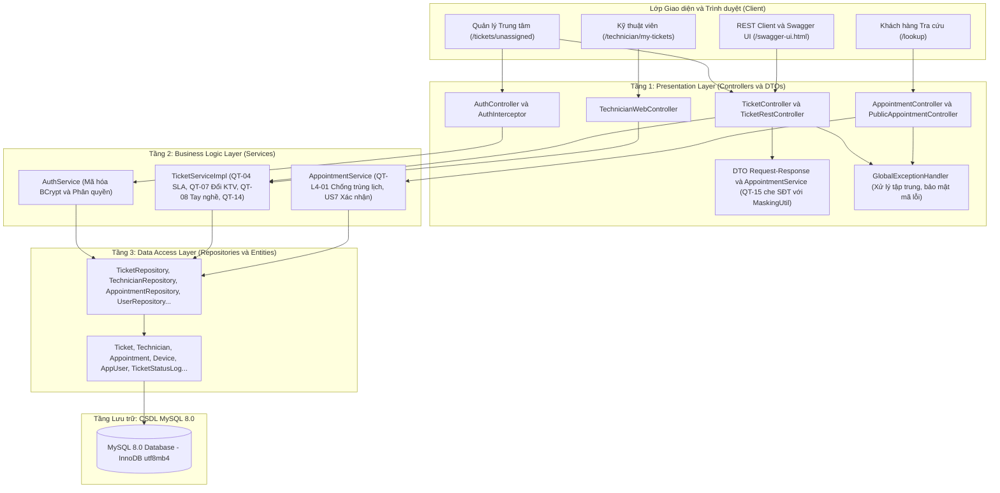

# Smart CRM – Hệ thống Quản lý Phân công Kỹ thuật viên & Lịch hẹn (Luồng L4)

---

## 1. Thông tin Sinh viên & Đề tài

- **Đơn vị đào tạo**: Đại học Văn Lang – Khoa Công nghệ Thông tin
- **Học phần**: Chuyên đề tốt nghiệp 1 (Học kỳ 1, Năm học 2026 – 2027)
- **Đề tài**: Hệ thống Mekong Mobile Smart CRM – Phân hệ Điều phối Dịch vụ Bảo hành
- **Mã luồng nghiệp vụ**: **L4** (Phân công Kỹ thuật viên & Đặt lịch hẹn giao nhận máy)
- **Track chuyên ngành**: **Software Engineering (SE)**
- **Giảng viên hướng dẫn**: TS. Nguyễn Trí Hải
- **Sinh viên thực hiện**: Bùi Đăng Khoa
- **Mã số sinh viên (MSSV)**: 2374802013428
- **Lớp**: L4-SE
- **Kho lưu trữ GitHub (Repository)**: [https://github.com/Bui-DangKhoa/CDTN1_BuiDangKhoa_L4.git](https://github.com/Bui-DangKhoa/CDTN1_BuiDangKhoa_L4.git)
- **Công nghệ nền tảng**: Java 21 LTS, Spring Boot 3.3.4, Spring Data JPA, MySQL 8.0 (InnoDB), Thymeleaf, Bootstrap 5, Docker & Docker Compose.

---

## 2. Sơ đồ & Mô tả Kiến trúc 3 Lớp (Three-Tier Architecture)

Dự án được tổ chức và phát triển tuân thủ nghiêm ngặt nguyên tắc **Kiến trúc 3 lớp (Three-Tier Architecture)** và **Phụ thuộc một chiều (Unidirectional Dependency)**: `Controllers (Web / REST) -> Services (Nghiệp vụ) -> Repositories (Dữ liệu)`.

### Sơ đồ luồng kiến trúc



### Mô tả phân định trách nhiệm các tầng
1. **Tầng 1 - Presentation Layer (`controllers`, `dto`, `exceptions`)**:
   - Tiếp nhận HTTP Request từ trình duyệt (Thymeleaf HTML5) và REST Client.
   - Kiểm tra tính hợp lệ của dữ liệu đầu vào bằng Bean Validation (`@Valid`, `@NotNull`, `@Min`...).
   - Chuyển tiếp yêu cầu sang Tầng Service; điều hướng giao diện Thymeleaf hoặc trả kết quả chuẩn hóa `ResponseErrorDto`.
   - **Cam kết**: Tuyệt đối không tương tác trực tiếp với `Repositories` hoặc CSDL; không chứa logic nghiệp vụ.
2. **Tầng 2 - Business Logic Layer (`services`)**:
   - Hiện thực 100% các quy tắc nghiệp vụ cốt lõi: Tính toán hạn SLA (QT-04), kiểm tra tay nghề KTV (QT-08), bắt buộc lý do đổi KTV (QT-07), chống gán trùng lịch hẹn (QT-L4-01), phân vùng trung tâm bảo hành (QT-14), che số điện thoại bảo mật (QT-15).
   - Quản lý giao dịch dữ liệu toàn vẹn bằng `@Transactional`.
   - Ghi nhật ký nghiệp vụ rõ ràng bằng thư viện SLF4J/Lombok (`@Slf4j`).
3. **Tầng 3 - Data Access Layer (`repositories`, `entities`)**:
   - Ánh xạ trực tiếp cấu trúc bảng CSDL chuẩn 3NF sang các thực thể JPA (`entities/`).
   - Khai báo các interface truy vấn dữ liệu thông qua Spring Data JPA (`repositories/`) kèm các hàm truy vấn tối ưu bằng JPQL hoặc chỉ mục INDEX phục vụ phi chức năng NFR.

---

## 3. Hướng dẫn Khởi chạy Zero-Setup (Tối đa 4 bước)

Hệ thống được thiết kế theo tiêu chí **Zero-Setup (Clone-and-Run)**, hỗ trợ triển khai tức thì trên máy chấm mà không cần cài đặt trước Maven, CSDL MySQL cục bộ hay công cụ build phức tạp:

### Bước 1: Sao chép mã nguồn từ GitHub
```bash
git clone --branch v0.2 https://github.com/Bui-DangKhoa/CDTN1_BuiDangKhoa_L4.git .
```

### Bước 2: Thiết lập biến môi trường
```bash
cp .env.example .env
# Trên hệ điều hành Windows PowerShell, có thể dùng:
# copy .env.example .env
```

### Bước 3: Xác nhận kiểm thử tự động (Unit Test PASS 100%)
```bash
./mvnw test
# Trên Windows PowerShell / Command Prompt:
# .\mvnw.cmd test
```
> **Kết quả kỳ vọng**: `Tests run: 25, Failures: 0, Errors: 0, Skipped: 0` – `BUILD SUCCESS`.

### Bước 4: Khởi chạy toàn bộ hệ thống bằng Docker Compose
> **Lưu ý quan trọng**: Nếu trên máy đã có volume CSDL từ các phiên bản trước đó, vui lòng chạy `docker compose down -v` một lần để dọn sạch volume cũ, đảm bảo cấu trúc bảng `technician` được cập nhật cột `user_id`, bảng `ticket` được cập nhật cột `resolution` (lịch sử xử lý) và nạp dữ liệu liên kết tài khoản mẫu chính xác nhất:
```bash
# Dọn sạch volume CSDL cũ (nếu đã từng khởi chạy trước đó):
docker compose down -v

# Khởi chạy toàn bộ hệ thống Spring Boot & MySQL 8.0 container:
docker compose up -d --build
```
> Ứng dụng Spring Boot và CSDL MySQL 8.0 sẽ tự động khởi động và sẵn sàng hoạt động tại: **[http://localhost:8080](http://localhost:8080)**.
> Xem tài liệu Swagger API tại: **[http://localhost:8080/swagger-ui.html](http://localhost:8080/swagger-ui.html)** (hoặc **[http://localhost:8080/swagger-ui/index.html](http://localhost:8080/swagger-ui/index.html)**).
> OpenAPI v3 JSON schema: **[http://localhost:8080/v3/api-docs](http://localhost:8080/v3/api-docs)**.

### 3.1. Tài liệu API Tương tác Swagger UI (SpringDoc OpenAPI v3)
Hệ thống tích hợp thư viện `springdoc-openapi-starter-webmvc-ui` phiên bản `2.6.0` (tương thích Spring Boot 3.3.4), hỗ trợ giao diện thử nghiệm API trực quan không yêu cầu đăng nhập:
- **Swagger UI Dashboard**: `http://localhost:8080/swagger-ui/index.html`
- **OpenAPI Specification**: `http://localhost:8080/v3/api-docs`
- **Bộ API CRUD Ticket**: `POST /api/v1/tickets`, `GET /api/v1/tickets/{id}`, `GET /api/v1/tickets`, `PUT /api/v1/tickets/{id}`, `DELETE /api/v1/tickets/{id}` (xóa mềm `deleted_at`).
- **Bộ API CRUD Appointment**: `POST /api/v1/appointments`, `GET /api/v1/appointments/{id}`, `GET /api/v1/appointments`, `PUT /api/v1/appointments/{id}`, `DELETE /api/v1/appointments/{id}` (hủy mềm `DA_HUY`).

---

## 4. Danh sách Tài khoản Mẫu để Test 3 Actors

Hệ thống đã nạp sẵn dữ liệu kiểm thử (Seed Data) đại diện cho 3 nhóm đối tượng người dùng (Actors) trong quy trình bảo hành:

| STT | Nhóm Actor | Tài khoản | Mật khẩu | Trung tâm / Phạm vi | Đường dẫn truy cập | Vai trò & Kịch bản kiểm thử |
| :---: | :--- | :--- | :--- | :--- | :--- | :--- |
| **1** | **Quản lý trung tâm** *(Manager)* | `quanly1` | `password123` | TT Quận 10 *(center_id: 1)* | `http://localhost:8080/login` &rarr; chuyển đến `/tickets/unassigned` | **Màn hình 1 & 2**: Xem danh sách phiếu chưa gán theo SLA (QT-14); mở Modal phân công KTV (FR2); lọc tay nghề $\ge$ 3 (QT-08); đổi KTV kèm nhập lý do $\ge$ 10 ký tự (QT-07); đặt lịch hẹn chống trùng giờ (QT-L4-01). |
| **2** | **Kỹ thuật viên** *(Technician)* | `ktv1` | `password123` | TT Quận 10 *(KTV Bậc 4)* | `http://localhost:8080/login` &rarr; chuyển đến `/technician/my-tickets` | **Màn hình 3**: Xem danh sách phiếu được gán (US4); cập nhật trạng thái đơn hướng (QT-06); tra cứu lịch sử sửa chữa và phát hiện thiết bị lặp lại sự cố (US5/FR6). |
| **3** | **Khách hàng** *(Public Portal)* | *Không cần đăng nhập* | *Không cần mật khẩu* | Toàn bộ hệ thống | `http://localhost:8080/lookup` | **Cổng Tra cứu Công khai**: Nhập Mã phiếu (`#BH-00125`) hoặc Số điện thoại; xem thông tin đã che SĐT (QT-15); bấm nút **Xác nhận lịch hẹn** (US7/FR7). |

---

## 5. Bảng đối chiếu Quy tắc Nghiệp vụ (Business Rules Traceability Matrix)

| Mã Quy tắc | Tên Quy tắc Nghiệp vụ | Mô tả Chi tiết Quy định Nghiệp vụ | Thành phần Mã nguồn Hiện thực | Phương pháp Kiểm chứng Đạt |
| :---: | :--- | :--- | :--- | :--- |
| **QT-03** | **Trạng thái tiếp nhận ban đầu** | Mọi phiếu bảo hành mới tạo đều phải có trạng thái mặc định là `MOI` (Mới). | `Ticket.java`, `schema.sql` (DEFAULT 'MOI') | Kiểm tra DDL CSDL và tạo mới ticket. |
| **QT-04** | **Tính hạn cam kết SLA** | Thời hạn xử lý (`due_date`) được tính dựa vào mức ưu tiên: **CAO** = +24 giờ; **TRUNG_BINH** = +72 giờ; **THAP** = +120 giờ. | `TicketServiceImpl.calculateDueDate(...)` | `TicketServiceTest.java` (PASS 100% 3 mức độ). |
| **QT-06** | **Vòng đời trạng thái đơn hướng** | Vòng đời chuyển trạng thái là một chiều: `MOI` &rarr; `DA_PHAN_CONG` &rarr; `DANG_XU_LY` &rarr; `HOAN_TAT` &rarr; `DONG`. Không cho phép quay lùi trạng thái (ví dụ từ `HOAN_TAT` về `DANG_XU_LY`). | `TicketServiceImpl.updateTicketStatus(...)` | `TicketServiceTest.java` & Màn hình KTV Khung 2 (chặn chuyển lùi trạng thái). |
| **QT-07** | **Lý do thay đổi KTV điều phối** | Khi thay đổi KTV đã được phân công trước đó, Quản lý bắt buộc phải nhập lý do thay đổi với độ dài **tối thiểu 10 ký tự**. Lý do được ghi vết vào bảng `ticket_status_log`. | `TicketServiceImpl.assignTechnician(...)`, `app.js`, `unassigned-list.html` | `TicketServiceTest.java` (Test 9 ký tự ném lỗi, 10 ký tự thành công); Form JS validation chặn submit. |
| **QT-08** | **Kiểm tra tay nghề KTV** | KTV được phân công phải cùng Trung tâm bảo hành (`center_id`) với phiếu và có tay nghề xử lý nhóm sự cố đó đạt **bậc $\ge$ 3**. | `TechnicianRepository.findEligibleTechnicians(...)`, `TicketServiceImpl.assignTechnician(...)` | `TicketServiceTest.java` (Từ chối KTV bậc 2 hoặc khác trung tâm). |
| **QT-L4-01** | **Chống trùng lịch hẹn KTV** | Không cho phép đặt lịch hẹn cho KTV nếu KTV đó đã có lịch hẹn khác trong cùng khung giờ, trừ khi lịch hẹn cũ đã bị hủy (`DA_HUY`). | `AppointmentRepository.existsByTechnician...`, `AppointmentService.scheduleAppointment(...)` | `AppointmentServiceTest.java` (Ném ngoại lệ `SCHEDULE_CONFLICT` khi trùng khung giờ). |
| **QT-14** | **Phân quyền & Phân vùng dữ liệu** | Quản lý trung tâm chỉ được xem và điều phối các phiếu bảo hành thuộc trung tâm mình phụ trách (`center_id`); không nhìn thấy phiếu của trung tâm khác. | `AuthInterceptor.java`, `TicketServiceImpl.getUnassignedTicketsSortedByDueDate(centerId)` | `AuthAndSecurityTest.java` & Đăng nhập `quanly1` chỉ hiển thị phiếu của Center 1. |
| **QT-15** | **Bảo mật SĐT Cổng công khai** | Trên Cổng tra cứu công khai cho khách hàng (`/lookup`), số điện thoại của khách hàng phải được che 4 số giữa (ví dụ: `0901234567` &rarr; `090****567`). | `PublicAppointmentController.java`, `AppointmentService.java` | `AuthAndSecurityTest.java` (PASS kiểm chứng che SĐT). |

---

## 6. Trạng thái Đóng gói & Phát hành Phiên bản

- [x] Sửa lỗi font UTF-8, đồng bộ cấu hình UTF-8 Spring Boot, MySQL JDBC và Thymeleaf.
- [x] Đồng bộ màu nền trắng `#ffffff`, viền `#e5e7eb` chuẩn Wireframe trên cả 3 màn hình.
- [x] Căn giữa Modal Phân công KTV (`modal-dialog-centered modal-lg`).
- [x] Chuyển ô `changeReason` thành input form động cho Quản lý kèm JS validation $\ge$ 10 ký tự (QT-07).
- [x] Bổ sung đầy đủ logging SLF4J trong các Service và cấu hình bảo mật `GlobalExceptionHandler`.
- [x] Hoàn thiện tài liệu kỹ thuật: `README.md`, `docs/thay-doi-thiet-ke.md`, `docs/ai-disclosure.md`.
- [x] Thử nghiệm kịch bản "Phép thử thư mục trống" (Clone-and-Run) đạt 100% Unit Test PASS.
- [x] Đóng gói và phát hành chính thức **Tag Release `v0.2`** hoàn tất Bài tập 2.
