# Test Report — Luồng L4: Phân công KTV và Lịch hẹn

- **Hệ thống:** Smart CRM – Mekong Mobile
- **Track:** Software Engineering (SE)
- **Người thực hiện:** Bùi Đăng Khoa – 2374802013428
- **Ngày cập nhật:** 12/11/2026
- **Môi trường:** Windows host with Docker Engine 29.7.2; Maven/Java 21 test run inside a disposable Linux builder container; MySQL 8.0 in an isolated Compose project.
- **Công cụ:** JUnit 5, Mockito, H2 theo cấu hình test; Swagger UI và MySQL cho kiểm tra trên hệ thống thật.

## 1. Cách thực thi và quản lý minh chứng

Lệnh được thử trên Windows:

    .\mvnw.cmd clean test "-DforkCount=0"

Wrapper không chạy test trực tiếp trên Windows trong phiên này: Java báo không tạo được `C:\.m2\...zip.part`; với cache wrapper chuyển vào thư mục tạm, Javac tiếp tục gặp `AccessDeniedException` khi đóng dependency JAR. Không sửa wrapper hay repo Maven của máy.

Lệnh chạy thành công trong builder container tạm (Java 21.0.12, Maven 3.9.16; mạng bật để tải Surefire JUnit provider còn thiếu):

    docker run --rm --entrypoint /bin/sh bt3l4release20261112-builder -c 'mvn clean test -DforkCount=0'

Lệnh chạy một phương thức:

    .\mvnw.cmd "-Dtest=TicketServiceTest#<ten_phuong_thuc>" test

Ảnh minh chứng đặt trong docs/screenshots/.

Ảnh mã nguồn mô tả cách kiểm tra; ảnh terminal hoặc log thể hiện kết quả thực thi. Với trường hợp từng FAIL, giữ riêng minh chứng trước và sau sửa.

## 2. Kết quả bộ kiểm thử tự động

Lần chạy thành công mới hoàn tất lúc 19:58 ngày 12/11/2026 (giờ Việt Nam):

| Chỉ số | Kết quả |
|---|---:|
| Tests run | 108 |
| Failures | 0 |
| Errors | 0 |
| Skipped | 0 |
| Tổng thời gian | 21,573 giây |
| Build | SUCCESS |

Minh chứng cũ: `docs/screenshots/BT3-final-tests-pass.png` (lượt trước). Ảnh terminal cho lượt mới chưa có: **CHÈN ẢNH: `BT3-builder-tests-pass.png` — output lệnh Docker builder và tổng kết 108/0/0/0**.

12 tình huống bên dưới là các tình huống được chọn để trình bày chi tiết. Kết quả toàn bộ 108 test không thay thế kiểm tra thủ công với CSDL thật.

## 3. Tổng hợp 12 tình huống

| Mã | Loại | Quy tắc/yêu cầu | Tầng | Kết quả đã xác nhận |
|---|---|---|---|---|
| TC-01 | Luồng đúng | QT-08 | Unit service | PASS |
| TC-02 | Biên 10 ký tự | QT-07 | Unit service | PASS |
| TC-03 | Biên 9 ký tự | QT-07 | Unit service | PASS |
| TC-04 | Luồng đúng qua Chủ nhật | QT-04 | Unit service | FAIL lần đầu → PASS sau sửa |
| TC-05 | Actor cập nhật trạng thái | BUG-01 | MockMvc, service mock | PASS |
| TC-06 | Luồng đúng | QT-13 | Unit service | PASS |
| TC-07 | Bảo vệ dữ liệu | QT-15 | Unit service | PASS |
| TC-08 | Chuyển trạng thái không hợp lệ | QT-06 | Unit service | FAIL lần đầu → PASS sau sửa |
| TC-09 | Xung đột lịch hẹn | QT-L4-01 | UI + MySQL | PASS theo quan sát UI và DB |
| TC-10 | KTV không đủ điều kiện | QT-08 | Unit service, eligible list mock rỗng | PASS |
| TC-11 | Bảo mật theo chủ sở hữu | A01 / quyền cập nhật | REST + MySQL | PASS |
| TC-12 | Dựng Docker và chạy lại test | Tái lập BT3 | Docker + kiểm thử tự động | PASS trong phạm vi đã ghi |

Tám tình huống là unit test service; TC-05, TC-09, TC-11 và TC-12 là các lớp kiểm tra riêng. Đây là 12 tình huống đại diện trong bộ 108 test, không phải 12 test cộng thêm.

## 4. Chi tiết test case

### TC-01 — Phân công KTV đủ điều kiện

- **Tiền điều kiện:** Phiếu ID 10 ở trạng thái MOI, chưa có KTV; trung tâm ID 1, nhóm sự cố ID 1. KTV ID 5 cùng trung tâm và được mock trong danh sách đủ điều kiện.
- **Các bước:** Gọi assignTechnician(10, 5, 101, "Phân công KTV xử lý sự cố nguồn"); kiểm tra đối tượng trả về và các lần gọi repository.
- **Dữ liệu thử:** ticketId=10; technicianId=5; assignedBy=101.
- **Kết quả mong đợi:** Trạng thái DA_PHAN_CONG; gán KTV ID 5; gọi lưu phiếu và nhật ký mỗi loại một lần.
- **Mức ưu tiên:** Cao.
- **Kết quả thực tế:** Các assertion về trạng thái, KTV và lời gọi lưu đều đạt. Chạy 1 test, không failure/error/skipped.
- **PASS/FAIL:** PASS.
- **Minh chứng:** docs/screenshots/TC-01.png và docs/screenshots/TC-01-pass.png.
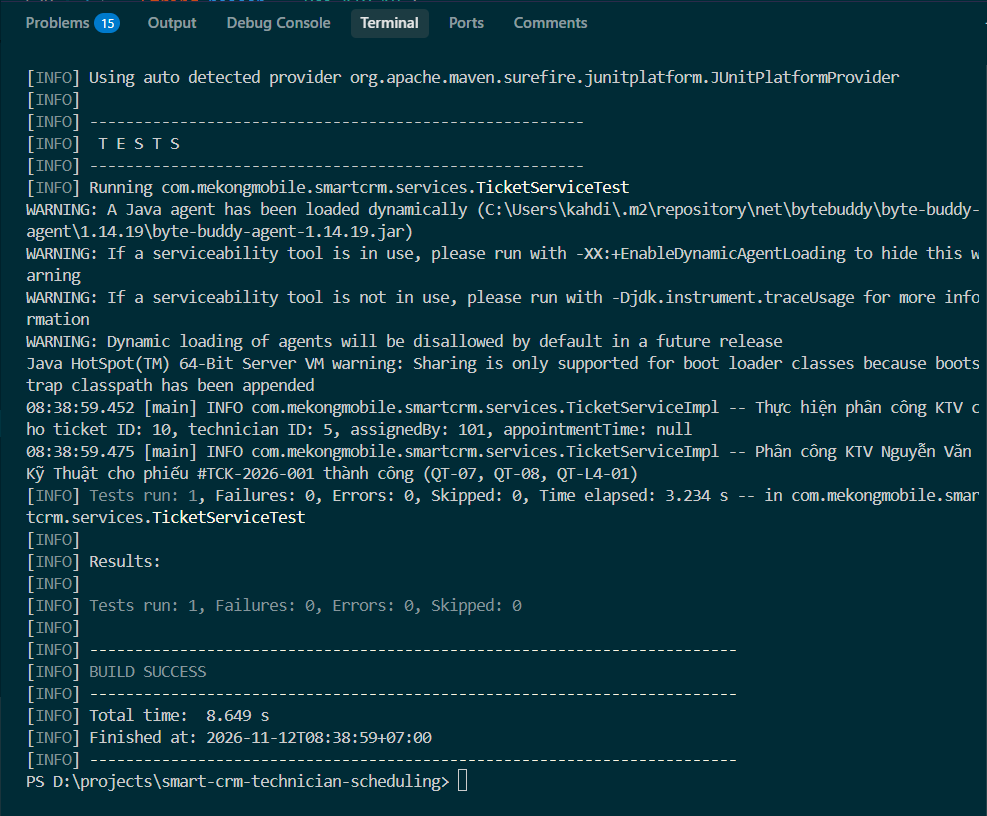

### TC-02 — Đổi KTV với lý do đúng 10 ký tự

- **Tiền điều kiện:** Phiếu ID 10 đã gán KTV ID 5. KTV mới ID 6 đủ điều kiện phân công.
- **Các bước:** Kiểm tra độ dài lý do; gọi assignTechnician(10, 6, 101, reason); kiểm tra KTV và trạng thái.
- **Dữ liệu thử:** reason="Doi KTV 10", dài đúng 10 ký tự.
- **Kết quả mong đợi:** Đổi sang KTV ID 6; trạng thái DA_PHAN_CONG; gọi lưu nhật ký một lần.
- **Mức ưu tiên:** Cao.
- **Kết quả thực tế:** Các assertion đạt. Chạy 1 test, không failure/error/skipped.
- **PASS/FAIL:** PASS.
- **Minh chứng:** docs/screenshots/TC-02.png và docs/screenshots/TC-02-pass.png.
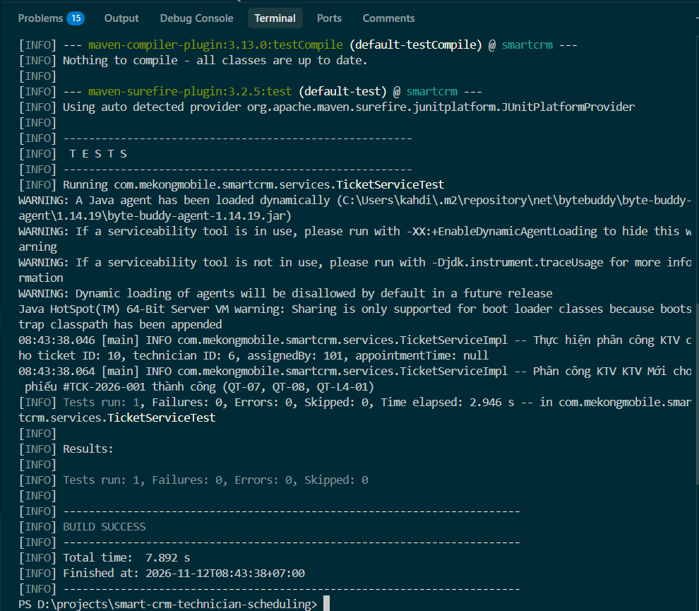

### TC-03 — Từ chối lý do đổi KTV dài 9 ký tự

- **Tiền điều kiện:** Phiếu ID 10 đã có KTV; KTV mới đủ điều kiện như TC-02.
- **Các bước:** Kiểm tra độ dài lý do; gọi phân công lại; kiểm tra ngoại lệ và việc không lưu dữ liệu.
- **Dữ liệu thử:** reason="Doi KTV m", dài 9 ký tự; technicianId mới=6.
- **Kết quả mong đợi:** AppException có mã INVALID_CHANGE_REASON; không gọi lưu phiếu hoặc nhật ký.
- **Mức ưu tiên:** Cao.
- **Kết quả thực tế:** Hệ thống từ chối lý do ngắn; assertion về mã lỗi và không gọi save đều đạt. Chạy 1 test, không failure/error/skipped.
- **PASS/FAIL:** PASS.
- **Minh chứng:** docs/screenshots/TC-03.png và docs/screenshots/TC-03-pass.png.
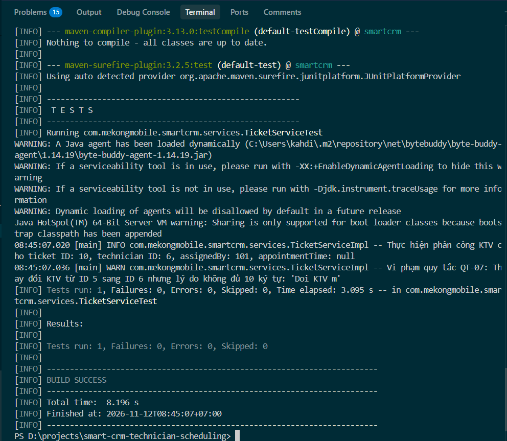

### TC-04 — Tính hạn cam kết bỏ qua Chủ nhật

- **Tiền điều kiện:** Thời điểm tiếp nhận được truyền cố định, không phụ thuộc ngày chạy.
- **Các bước:** Chạy phương thức TicketServiceTest#TC04_dueDate_skipsSunday; đối chiếu hạn cam kết.
- **Dữ liệu thử:** receivedAt=2026-11-07T15:00; priority=CAO; thời lượng SLA=24 giờ trên các ngày thứ Hai đến thứ Bảy.
- **Kết quả mong đợi:** dueDate=2026-11-09T15:00.
- **Mức ưu tiên:** Cao.
- **Kết quả thực tế:** Lần đầu nhận 2026-11-08T15:00, test FAIL. Sau sửa, lần chạy lại có 1 test, không failure/error/skipped và BUILD SUCCESS.
- **PASS/FAIL:** FAIL lần đầu → PASS sau sửa.
- **Minh chứng:** docs/screenshots/TC-04.png và docs/screenshots/TC-04-after-pass.png.
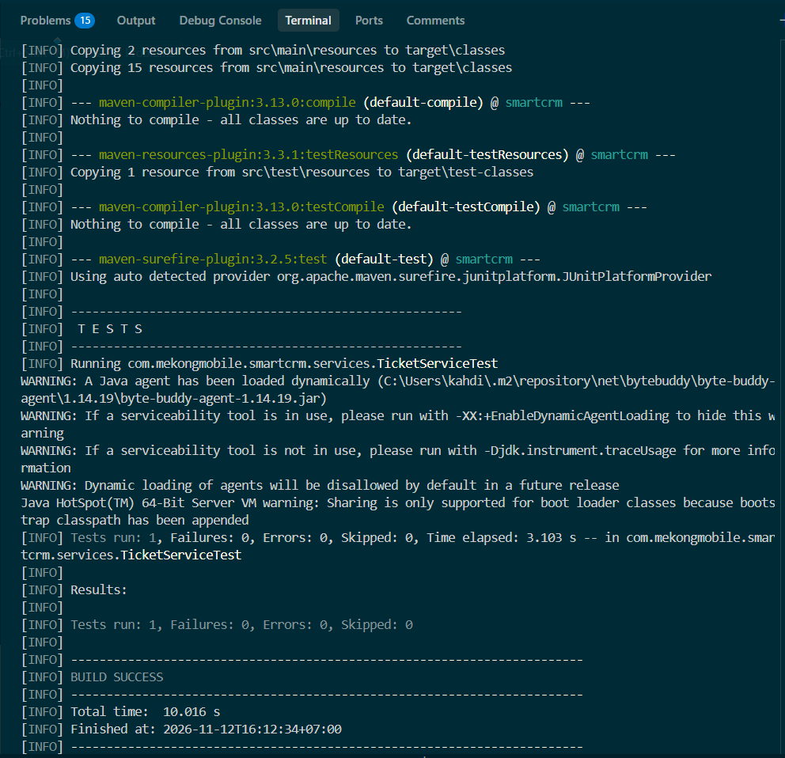
- **Ghi chú truy vết:** Không gắn trường hợp này với BUG-02; BUG-02 trong Bug Log chính là lỗi cho phép đặt lịch quá khứ.

### TC-05 — Controller truyền đúng ID tài khoản khi cập nhật trạng thái

- **Tiền điều kiện:** MockMvc khởi tạo controller với service được mock. Phiên đăng nhập ktv1 có userId=2, role=KY_THUAT_VIEN, centerId=1; KTV liên kết có technicianId=1.
- **Các bước:**
  1. Chạy test ThymeleafViewsTest#testUpdateStatus_ChangedByUsesUserIdNotTechnicianId.
  2. Test gửi POST /technician/tickets/106/status với nextStatus=DANG_XU_LY và phiên đăng nhập ktv1.
  3. Dùng ArgumentCaptor bắt UpdateTicketStatusDto được controller truyền vào ticketService.updateTicketStatus.
  4. Kiểm tra changedBy trong DTO bằng userId=2, không phải technicianId=1.
- **Dữ liệu thử:** ticketId=106; nextStatus=DANG_XU_LY; userId=2; technicianId=1.
- **Kết quả mong đợi:** Controller trả phản hồi chuyển hướng 3xx, gọi service cập nhật phiếu 106 và truyền changedBy=2.
- **Mức ưu tiên:** Cao.
- **Kết quả thực tế:** Test chạy thành công lúc 17:10 ngày 12/11/2026; Tests run: 1, Failures: 0, Errors: 0, Skipped: 0; BUILD SUCCESS.
- **PASS/FAIL:** PASS.
- **Minh chứng:** docs/screenshots/TC-05-audit-pass.png; docs/screenshots/TC-05-audit-assertions.png.
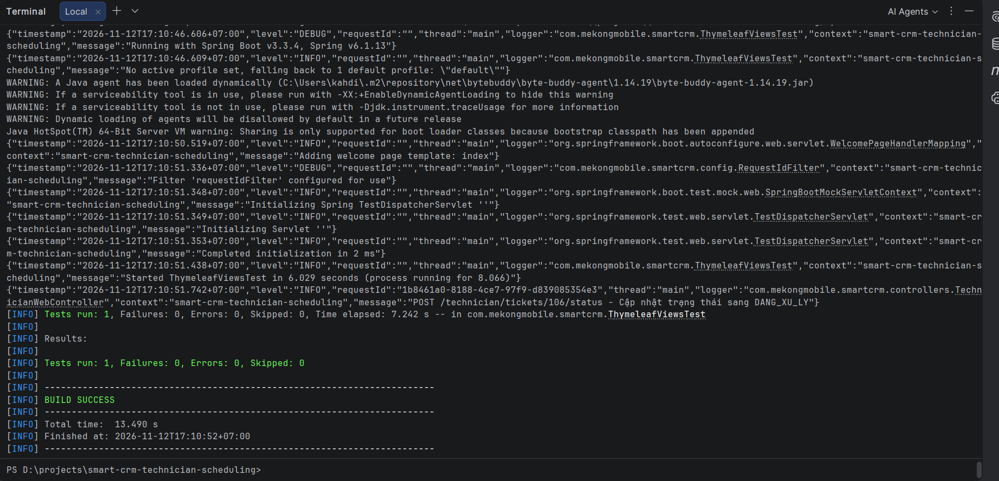
- **Truy vết:** BUG-01 — Nhầm ID KTV với ID tài khoản thực hiện.
- **Giới hạn:** Test kiểm tra controller truyền đúng actor cho service. Service được mock nên test không chứng minh việc chuyển trạng thái và lưu nhật ký trên CSDL thật.

### TC-06 — Xóa mềm phiếu MOI

- **Tiền điều kiện:** Phiếu ID 10 có status=MOI, deletedAt=null và không có lịch hẹn còn hiệu lực.
- **Các bước:** Gọi deleteTicket(10, 1); kiểm tra phiếu và bắt đối tượng nhật ký.
- **Dữ liệu thử:** ticketId=10; actorUserId=1.
- **Kết quả mong đợi:** deletedAt có giá trị; status vẫn MOI; gọi lưu phiếu; nhật ký có fromStatus=MOI và toStatus=DA_XOA.
- **Mức ưu tiên:** Cao.
- **Kết quả thực tế:** Các assertion nêu trên đạt. Chạy 1 test, không failure/error/skipped.
- **PASS/FAIL:** PASS.
- **Minh chứng:** docs/screenshots/TC-06.png và docs/screenshots/TC-06-pass.png.
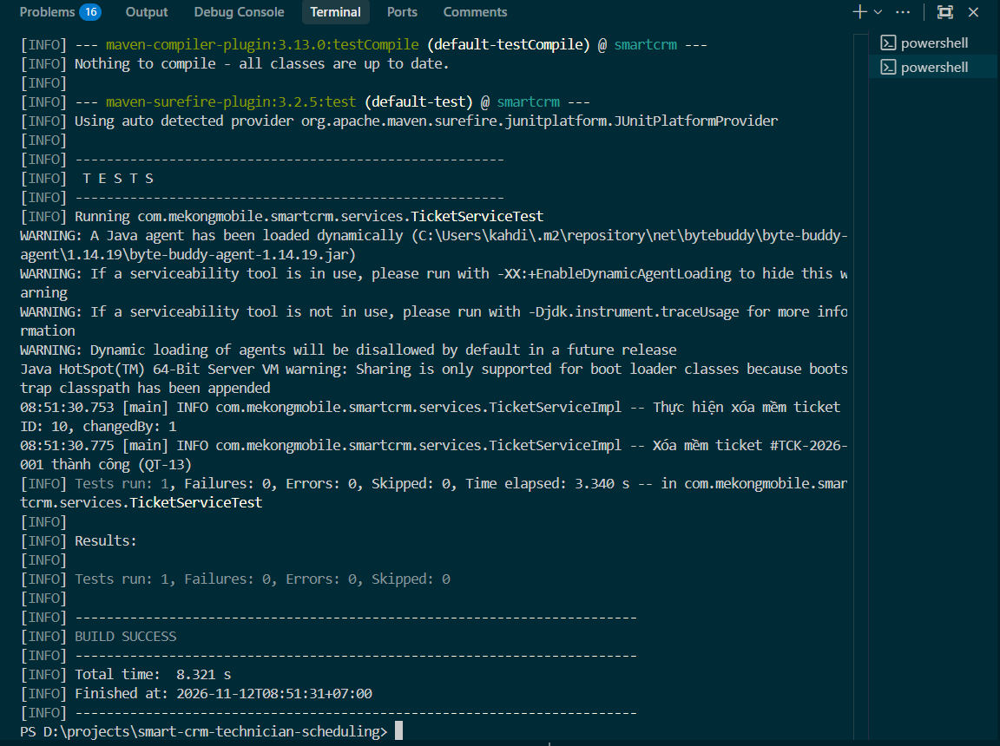
- **Giới hạn:** Minh chứng này thuộc tầng unit; chưa phải kiểm tra việc giữ bản ghi trên MySQL thật.

### TC-07 — Che số điện thoại trong dữ liệu trả cho KTV

- **Tiền điều kiện:** Phiếu được mock gán cho KTV ID 5, có SĐT khách hàng 0901234567.
- **Các bước:** Gọi getTicketsForTechnician(5); kiểm tra số phần tử và customerPhone trong DTO.
- **Dữ liệu thử:** technicianId=5; customerPhone đầu vào=0901234567.
- **Kết quả mong đợi:** Trả một phiếu với customerPhone=090****567.
- **Mức ưu tiên:** Cao.
- **Kết quả thực tế:** Lần chạy unit test được ghi nhận thành công: 1 test, không failure/error/skipped, BUILD SUCCESS.
- **PASS/FAIL:** PASS.
- **Minh chứng:** docs/screenshots/TC-07.png và docs/screenshots/TC-07-unit-pass.png.
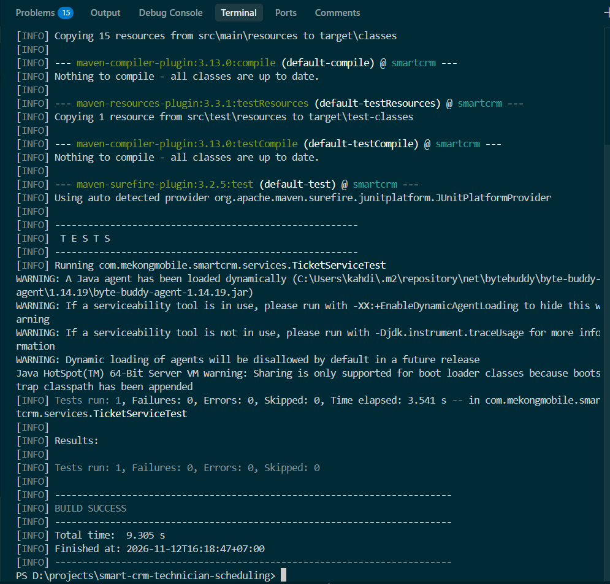
- **Giới hạn:** Kết luận áp dụng cho dữ liệu trả về của phương thức được kiểm tra, không suy rộng cho mọi endpoint.

### TC-08 — Từ chối chuyển trạng thái bỏ bước

- **Tiền điều kiện:** Phiếu ID 10 ở trạng thái DA_PHAN_CONG.
- **Các bước:** Gọi updateTicketStatus với newStatus=HOAN_TAT; kiểm tra ngoại lệ, trạng thái phiếu và các lời gọi lưu.
- **Dữ liệu thử:** ticketId=10; newStatus=HOAN_TAT; changedBy=2.
- **Kết quả mong đợi:** Từ chối chuyển trạng thái; phiếu giữ DA_PHAN_CONG; không lưu phiếu hoặc nhật ký.
- **Mức ưu tiên:** Cao.
- **Kết quả thực tế:** Lần đầu không ném ngoại lệ nên test FAIL. Sau sửa, test chạy lại thành công: 1 test, không failure/error/skipped.
- **PASS/FAIL:** FAIL lần đầu → PASS sau sửa.
- **Minh chứng:** docs/screenshots/TC-08.png; docs/screenshots/TC-08-fail.png; docs/screenshots/TC-08-after-pass.png.
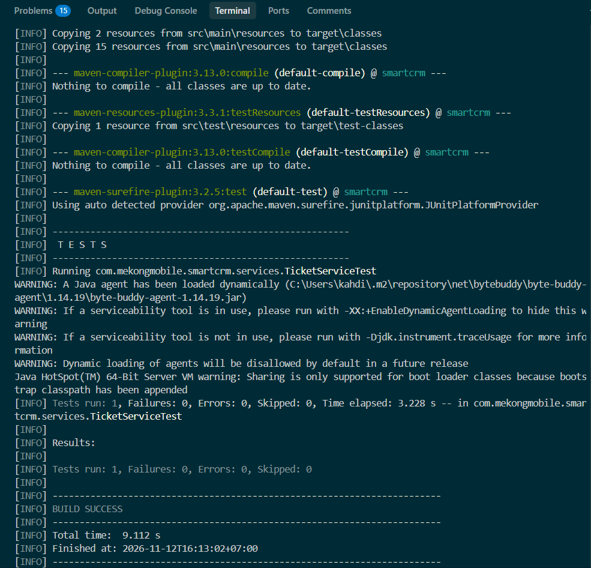

### TC-09 — UI từ chối lịch hẹn xung đột và giữ nguyên dữ liệu

- **Tiền điều kiện:** Dữ liệu trên MySQL thử; phiếu 102 (`TK-202610-002`) ở trạng thái MOI, KTV Lê Văn An có lịch cùng khung giờ ngày 25/11/2026 lúc 14:00.
- **Các bước:** Qua UI thử phân công phiếu 102 cho Lê Văn An ở thời điểm đó; kiểm tra thông báo và đối chiếu dữ liệu trước/sau trong DB.
- **Dữ liệu thử:** Phiếu 102; Lê Văn An; 25/11/2026 14:00.
- **Kết quả mong đợi:** UI từ chối lịch trùng; phiếu và số liệu liên quan không đổi.
- **Mức ưu tiên:** Cao.
- **Kết quả thực tế:** UI hiển thị “KTV đã có lịch hẹn khác trong cùng khung giờ này”. Trước/sau: phiếu MOI, `technician_id=NULL`, tổng lịch hẹn 7→7, log của phiếu 0→0.
- **Giới hạn:** Lần kiểm tra UI này không quan sát HTTP 409; không khẳng định status code.
- **PASS/FAIL:** PASS.
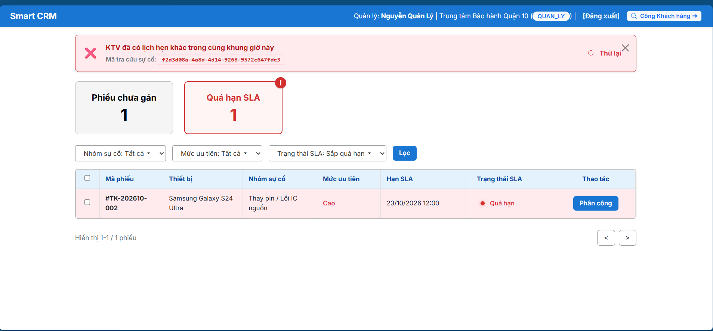
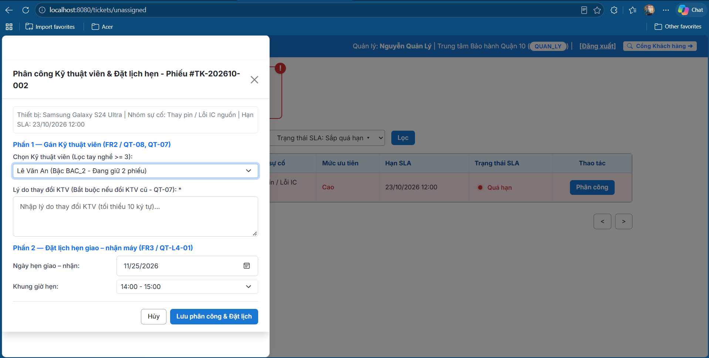
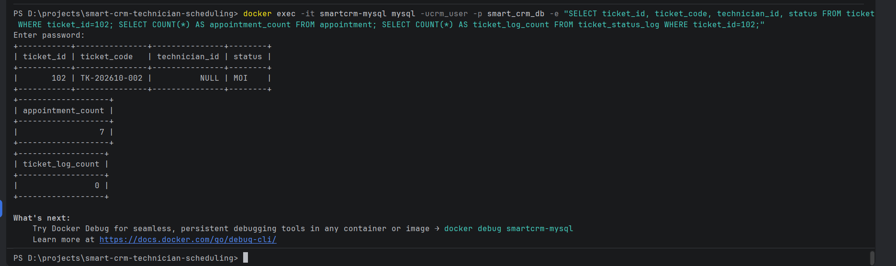

### TC-10 — Từ chối KTV không nằm trong danh sách đủ điều kiện

- **Tiền điều kiện:** Phiếu ID 10 và KTV ID 5 tồn tại trong fixture. Mock findEligibleTechnicians(1, 1) trả danh sách rỗng.
- **Các bước:** Gọi assignTechnician(10, 5, 101, "Phân công kiểm tra"); kiểm tra mã ngoại lệ và các lời gọi lưu.
- **Dữ liệu thử:** ticketId=10; technicianId=5; assignedBy=101; danh sách KTV đủ điều kiện rỗng.
- **Kết quả mong đợi:** AppException có mã KTV_NOT_QUALIFIED; không gọi lưu phiếu hoặc nhật ký.
- **Mức ưu tiên:** Cao.
- **Kết quả thực tế:** Hệ thống từ chối phân công; các assertion đạt. Chạy 1 test, không failure/error/skipped.
- **PASS/FAIL:** PASS.
- **Minh chứng:** docs/screenshots/TC-10.png và docs/screenshots/TC-10-pass.png.
- **Giới hạn:** Đây là unit test xử lý kết quả truy vấn rỗng; chưa kiểm tra truy vấn thật lọc theo proficiency, trung tâm hoặc trạng thái active.
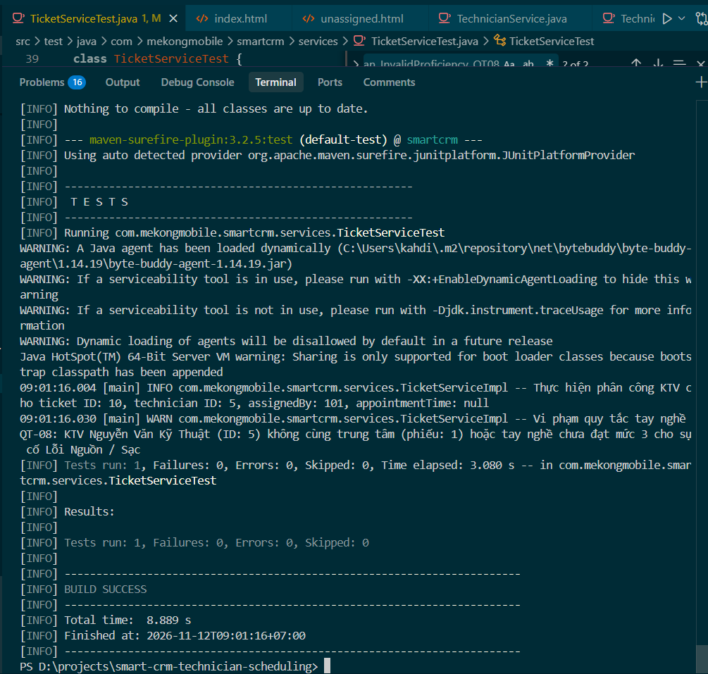

### TC-11 — Chặn KTV cập nhật phiếu của người khác

- **Tiền điều kiện:** Đăng nhập ktv1 có userId=2, liên kết technicianId=1. Phiếu ID 105 thuộc technicianId=2 và đang DA_PHAN_CONG.
- **Các bước:**
  1. Ghi nhận tài khoản, liên kết KTV và dữ liệu phiếu.
  2. Trong Swagger, gửi PATCH /api/v1/tickets/105/status bằng phiên đăng nhập ktv1.
  3. Kiểm tra mã HTTP và nội dung lỗi.
  4. Truy vấn lại phiếu và ticket_status_log.
- **Dữ liệu thử:** ticketId=105; newStatus=DANG_XU_LY; changedBy=2; changeReason="Kiem tra quyen cap nhat phieu".
- **Kết quả mong đợi:** HTTP 403, mã FORBIDDEN_NOT_OWNER; phiếu giữ DA_PHAN_CONG, KTV phụ trách không đổi; không thêm nhật ký do request này.
- **Mức ưu tiên:** Cao.
- **Kết quả thực tế:** API trả HTTP 403, mã FORBIDDEN_NOT_OWNER, thông báo phiếu không thuộc KTV đang đăng nhập. Truy vấn sau request cho thấy phiếu 105 vẫn thuộc KTV 2, status=DA_PHAN_CONG; truy vấn nhật ký không trả dòng nào cho phiếu 105.
- **PASS/FAIL:** PASS.
- **Minh chứng:** docs/screenshots/TC-11-user-technician-mapping.png; docs/screenshots/TC-11-before-ticket-list.png; docs/screenshots/TC-11-after-denied.png; docs/screenshots/TC-11-after-denied-detail.png; docs/screenshots/TC-11-after-db.png.
- **Giới hạn:** Swagger hiển thị schema thành công 200 không phải response lần chạy này; kết quả quan sát là 403.
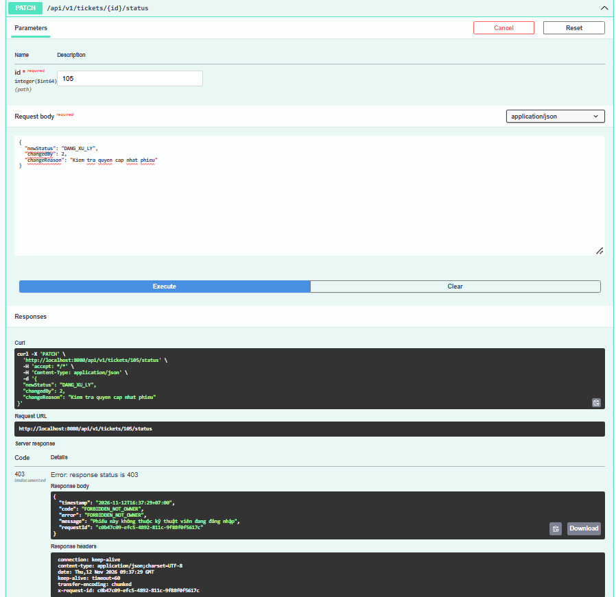
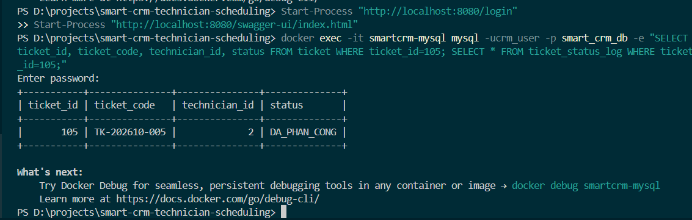

### TC-12 — Dựng sạch hệ thống và chạy lại kiểm thử

- **Tiền điều kiện:** Docker hoạt động; TC-12 đã dùng volume mới và seed của dự án.
- **Các bước:**
  1. Dựng project với volume mới trong môi trường thử.
  2. Chạy docker compose up -d --build.
  3. Kiểm tra app và MySQL đều healthy.
  4. Đếm bản ghi ticket, technician và app_user; đối chiếu dữ liệu seed.
  5. Đăng nhập bằng tài khoản mẫu và kiểm tra dữ liệu hiển thị.
  6. Chạy bộ kiểm thử hai lần trên cùng mã nguồn, với dữ liệu thử được khởi tạo lại theo cấu hình test.
  7. So sánh tổng số test và kết quả hai lần.
- **Dữ liệu thử:** Seed hiện tại của dự án; tài khoản quanly1 và ktv1; cùng mã nguồn cho hai lần chạy.
- **Kết quả mong đợi:** Dựng sạch thành công; hai dịch vụ healthy; đăng nhập được, có dữ liệu mẫu; hai lần kiểm thử có cùng số test và đều không failure/error/skipped.
- **Mức ưu tiên:** Cao.
- **Kết quả thực tế đã ghi nhận:** Hệ thống khởi động với volume mới; app và MySQL healthy; CSDL ban đầu có 11 phiếu, 4 KTV và 2 tài khoản. Đăng nhập `quanly1` thành công; UI hiển thị 2 phiếu chưa phân công. Hai lượt test lịch sử đều có 108 test, không failure/error/skipped và BUILD SUCCESS; 22,236 giây và 22,723 giây. Build dùng cache. Trong lần kiểm tra BT3 cô lập, `schema.sql` chạy lại hai lần và `data-demo.sql`/`auth_data.sql` mỗi file chạy lại một lần; mọi lệnh exit 0 và counts trước/sau vẫn 11/4/2.
- **PASS/FAIL:** PASS.
- **Minh chứng:** `docs/screenshots/TC-12-clean-environment.png`; `TC-12-containers-healthy.png`; `TC-12-seed-counts.png`; `TC-12-app-working.png`; `TC-12-run1-pass.png`; `TC-12-run2-pass.png`.
- **Giới hạn:** Đây không phải build máy trắng (dùng cache) và không chứng minh clone tag trên host khác. C8 được kiểm tra bằng chạy lại DDL và seed trong DB cô lập; khởi động lại app riêng lẻ không chạy lại script MySQL init.
- **Minh chứng:**
  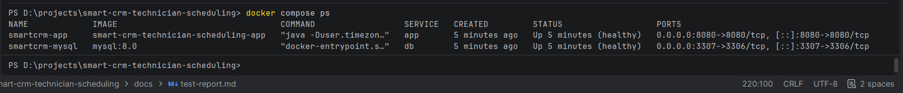
  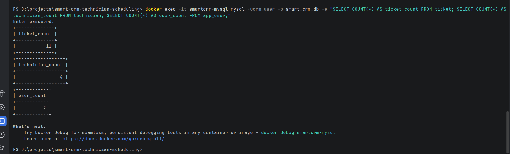
  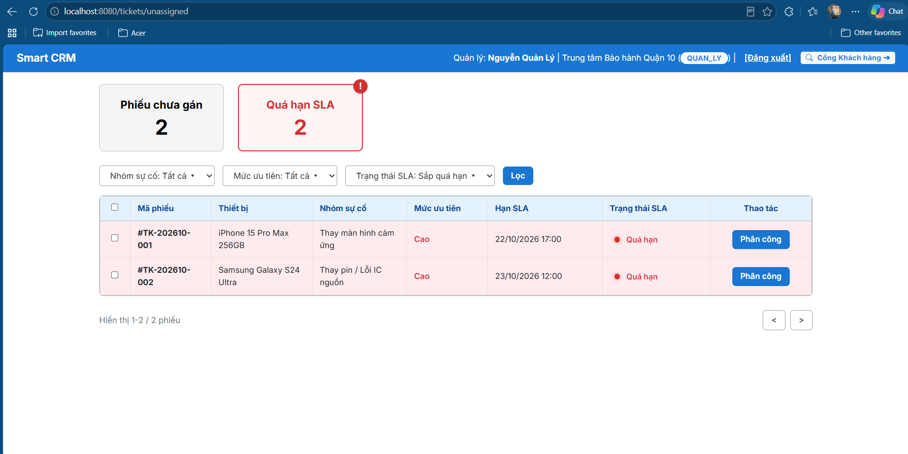

## 5. Kết luận và giới hạn

Bộ kiểm thử tự động mới nhất chạy được trong builder container có 108 test, không failure/error/skipped và BUILD SUCCESS. Lệnh Windows Wrapper chưa chạy thành công do lỗi môi trường/cache nêu trên.

Các hồ sơ TC-01 đến TC-12 ghi nhận PASS trong phạm vi mô tả từng ca. TC-10 dùng mock; TC-05 dùng service mock; TC-09 không xác nhận HTTP status; TC-12 dùng cache và builder cùng host.

Các unit test và controller test dùng mock không được coi là minh chứng ghi dữ liệu vào MySQL thật.
